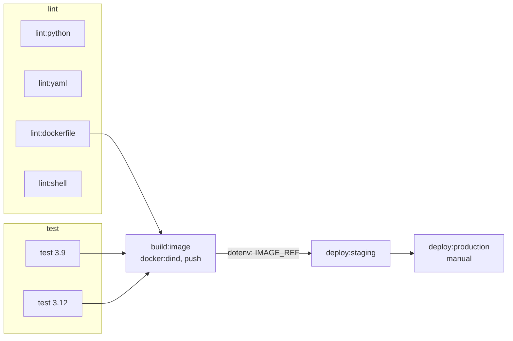

# gitlab-ci-pipeline

[](https://github.com/Walaskien/gitlab-ci-pipeline/actions/workflows/ci.yml)

A `.gitlab-ci.yml` for a small Flask service: lint, tests on Python 3.9 and 3.12, an image build with docker:dind pushed to the GitLab Container Registry, and a staging deploy plus a manual production-like deploy with docker compose.

The repo lives on GitHub. The pipeline file is written for a GitLab runner, so on GitHub it is only parsed and partly run through [gitlab-ci-local](https://github.com/firecow/gitlab-ci-local), see below.

## The problem

GitLab CI shows up in a lot of job posts and my day to day tool is GitHub Actions. I have not run GitLab CI in production. I wanted a pipeline that uses the GitLab way of doing things (rules, needs, environments, resource groups, include and extends) instead of a workflow translated line by line, and I wanted to know which parts of it I can check without a runner and which I cannot.

## Pipeline



`test` has `needs: []`, so it starts together with the lint jobs instead of waiting for the lint stage. `build:image` waits only for `lint:dockerfile` and the tests, the other lint jobs do not hold it back.

What is where:

| GitLab feature | Where |
| --- | --- |
| `workflow:rules` (no double pipelines for a branch with an open MR) | `.gitlab-ci.yml` |
| `rules` with `if`, `when: manual`, `rules:variables` instead of `only/except` | `build:image`, `deploy:*` |
| `needs` as a DAG, `needs:artifacts`, dotenv report passing `IMAGE_REF` | `build:image` to `deploy:*` |
| `parallel:matrix` on Python 3.9 and 3.12 | `test` |
| `cache` keyed by requirements files, `artifacts` with a JUnit report | `.python`, `test` |
| `include:local`, `extends`, `!reference`, YAML anchors | `ci/templates.yml`, `ci/deploy.yml` |
| `services` (docker:dind), registry login with `CI_REGISTRY_*` | `.dind`, `build:image` |
| `environment`, `resource_group`, manual gate | `ci/deploy.yml` |
| `retry`, `timeout`, `interruptible`, `after_script` | `default`, `.dind`, `.deploy` |

Anchors only work inside one file, which is why `.gitlab-ci.yml` and `ci/deploy.yml` each have their own and everything shared between files goes through `extends` and `!reference`.

Image tags: `build:image` always builds `$CI_REGISTRY_IMAGE:$CI_COMMIT_SHORT_SHA` and runs it once on the dind daemon to ask `/health` and `/` for the version. Merge request pipelines stop there. The default branch and tags push, and the default branch also moves `:latest`.

### Choices

- **dind, not kaniko.** kaniko needs no privileged container, which is its good side. But the upstream repository was archived in 2025, and I did not want a new pipeline built on a tool nobody maintains upstream. According to the docs, docker:dind works on the gitlab.com hosted Linux runners without extra setup. The price is a privileged service, so on a self-hosted runner this is something to decide on purpose.
- **docker compose, not kind.** kind inside dind works, but it needs the API server address rewritten to reach the sidecar, and kind stays off my laptop (CI does that job), so I could not have tested any of it. compose has the same shape (an image, a health check, a smoke test) with far fewer moving parts. The Helm and kind side is in [cicd-k8s-delivery](https://github.com/Walaskien/cicd-k8s-delivery).
- **parallel:matrix, not a child pipeline.** The matrix does what is needed here and gitlab-ci-local can run it. A child pipeline would have been a trigger job I cannot run locally.
- **`allow_failure: true` on the manual job.** A manual job inside `rules` defaults to `allow_failure: false`, which leaves the pipeline in "blocked" until somebody plays it. I want a green pipeline with a play button.

## Quick start

You need python3, docker and make. Node and npm only for the gitlab-ci-local targets.

```
make venv           # ruff, yamllint, pytest, pytest-cov in .venv
make lint
make test
make image          # builds the image, runs it, checks /health and the version
make gcl-install    # gitlab-ci-local into .tools/gcl, needs node and npm
make gcl-preview    # gitlab-ci-local --preview: the config with includes resolved
make gcl            # runs the lint jobs and the test matrix in docker
```

`make gcl JOBS="lint:python 'test: [3.9]'"` runs other jobs. gitlab-ci-local only sees files that git tracks, so `git add` new files before running it.

## How to run it on gitlab.com

Everything below is written from the docs, I have not done it yet, see "Run on gitlab.com" under Verified.

1. Make an empty project on gitlab.com in your namespace, called `gitlab-ci-pipeline`. No README, no template.
2. Get the code there. Either of these:
   - Import: New project, Import project, Repository by URL, paste the GitHub clone URL of this repo (it is public, no credentials needed).
   - Second remote: `git remote add gitlab https://gitlab.com/<namespace>/gitlab-ci-pipeline.git` and `git push gitlab main`.
3. Shared runners: Settings, CI/CD, Runners, check that the instance runners toggle is on for the project. A new account may be asked to verify itself before the runners take jobs; if jobs sit in "pending", the pipeline page says why.
4. The Container Registry is on by default for new projects (Deploy, Container Registry). Nothing to configure for the push: the job logs in with `CI_REGISTRY_USER` and `CI_REGISTRY_PASSWORD`, which GitLab sets for every job.
5. The pipeline starts on the push or the import. On `main` expect: four lint jobs and two test jobs, `build:image`, `deploy:staging`, and `deploy:production` waiting for a click (Build, Pipelines, the play button on the job).
6. Copy what you saw into "Run on gitlab.com" below. If a job fails, the job log and the `deploy.log` artifact are where to look first.

The `dind` jobs need a runner that allows privileged services. The docs say the gitlab.com hosted Linux runners run in privileged mode for Docker-in-Docker, except the ones with the `gitlab-org` tag, and this pipeline does not set `tags:`.

## Verified

Mac with Colima. Python 3.9.6 from the system, Node 24.22.2 unpacked into `.tools/` inside the project, gitlab-ci-local 4.77.1 installed with `npm install --prefix .tools/gcl`, nothing global.

### Locally

- `pytest --cov=app` on Python 3.9.6 in a venv: 11 passed, 100% coverage. `ruff check`, `ruff format --check` and `yamllint -s` on the repo: clean.
- `gitlab-ci-local --preview`: the config parses with both includes resolved, and gitlab-ci-local reports that it validated against the JSON schema. `--list` shows nine jobs with the matrix expanded to `test: [3.9]` and `test: [3.12]`.
- The same `--list` on a feature branch shows only the lint and test jobs. With `CI_PIPELINE_SOURCE=merge_request_event` it adds `build:image`, with `CI_COMMIT_TAG` set it shows `build:image` only, and on `main` it also shows both deploy jobs, `deploy:production` as `manual`. That is the `rules` logic doing what the comments say.
- `gitlab-ci-local lint:python lint:yaml lint:dockerfile lint:shell`: all four PASS, in `python:3.12-slim`, `hadolint/hadolint:v2.12.0-debian` and `koalaman/shellcheck-alpine:v0.10.0`.
- `gitlab-ci-local 'test: [3.9]' 'test: [3.12]'`: both PASS, 11 tests each, on Python 3.9.25 and 3.12. The `coverage:` regex picked up 100% from the pytest-cov table and the `after_script` ran. gitlab-ci-local exported and imported the cache, but pip then warned that `.cache/pip` is not owned by the current user and disabled it, so every run downloaded the packages again. I take that for a gitlab-ci-local file ownership quirk, but I did not dig into it, so whether the pip cache pays off is not shown.
- `make image`: the `docker build` and `scripts/container-smoke.sh` part of `build:image` on the local daemon, answers `/health` and the version. My local docker used the classic builder, not BuildKit, so `BUILDKIT_INLINE_CACHE` and `--cache-from` have not been tried.
- The deploy half, with the compose plugin from `docker:27.5.1` (compose v2.33.0) against the local daemon instead of dind: `docker compose up -d --wait` returned once the container was `Healthy`, staging on port 19081 and production on 19082 side by side, each answering with its own `APP_ENV`. `scripts/smoke.sh` passed from the host with curl and inside `docker:27.5.1`, which has wget and no curl, so the fallback is needed. With a wrong expected version it exits 1, and `docker compose config` without `IMAGE_REF` stops with the "set IMAGE_REF" message. Everything was removed afterwards.
- `actionlint` 1.7.12 on `.github/workflows/ci.yml`: no findings.
- The mermaid diagram was not rendered, the mermaid-cli image could not start Chrome here.

### Not run: needs a GitLab runner

These jobs are only parsed, never executed, because they need a docker:dind service, the GitLab registry or a job token that gitlab-ci-local does not provide:

- `build:image`: `docker login` against `CI_REGISTRY`, the push, the dotenv report.
- `deploy:staging` and `deploy:production`: the compose deploy on the dind daemon, `environment`, `resource_group`, the manual gate.
- `retry`, `timeout`, `interruptible` and `resource_group` have no effect locally, they are GitLab features.
- The `pull_request` and merge request paths of `workflow:rules`.

### On GitHub Actions

Hosted runner `ubuntu-24.04` (image version 20261101.360.1). Only `push` events to `main` so far.

- First run, on the commit with the readme: all four jobs green in 38 s end to end. yamllint 10 s, tests 3.12 11 s, tests 3.9 19 s, gitlab-ci-local 36 s. Inside the gitlab-ci-local job `--preview` and `--list` passed, the four lint jobs PASS, and `test: [3.9]` and `test: [3.12]` PASS with 11 tests each (Python 3.9.25 and 3.12.16) and 100% coverage. So the pipeline file also parses and the jobs run on a fresh runner, not only on my Mac.
- That run printed an npm `EBADENGINE` warning: gitlab-ci-local 4.77.1 wants Node 24.14 or newer and the workflow had Node 22. It worked anyway. I changed `node-version` to 24 (Node 24.22.2 from the runner tool cache) in a follow-up commit.
- Second run after that fix: green in 44 s (yamllint 9 s, tests 3.9 15 s, tests 3.12 13 s, gitlab-ci-local 40 s), and the warning is gone.
- This is gitlab-ci-local on GitHub, not GitLab CI. `build:image` and the deploy jobs are still not run anywhere.
- Not seen yet: the `pull_request` path and the `cancel-in-progress` rule.

### Run on gitlab.com

Not run yet. To fill in after the first pipeline:

- Date:
- Project and pipeline URL:
- Runner (shared or not), Docker and compose versions from the job log:
- Jobs that passed:
- Jobs that failed, and what I changed to fix them:
- Image tags in the registry after the run:
- `deploy:production` played by hand, result:

## Limitations

- The deploy jobs deploy to the Docker daemon of the dind service, which is gone when the job ends. So `staging` and `production` in GitLab's environment list are records of a deployment, not places that stay up. The compose file and the smoke test are real, the target is not. Pointing `DOCKER_HOST` at a real host over ssh would be the next step, and I have not tried it.
- The production-like job is the same compose file as staging with another project name, port and `APP_ENV`. There is no separate infrastructure behind it.
- The notes are kept in process memory, one gunicorn worker. This is a demo service for the pipeline, not something to store data in.
- Python 3.9 is past its end of life. It is in the matrix because I wanted a real two-version matrix.
- Registry cleanup policies, protected variables and environments, and merge request approvals are project settings and not in this repo.

## Layout

```
.gitlab-ci.yml            stages, workflow, default, lint, test, build:image
ci/templates.yml          .python, .dind, rule sets
ci/deploy.yml             deploy:staging, deploy:production
deploy/docker-compose.yml
app/                      Flask service
tests/                    pytest
scripts/                  smoke.sh (HTTP), container-smoke.sh (docker exec)
.github/workflows/ci.yml  yamllint, tests, gitlab-ci-local on GitHub
Dockerfile, Makefile
```

## Related

- [cicd-k8s-delivery](https://github.com/Walaskien/cicd-k8s-delivery): the same kind of delivery chain on GitHub Actions, with Helm and kind and an automatic rollback.
- [zero-downtime-deploy-ansible](https://github.com/Walaskien/zero-downtime-deploy-ansible): rolling deploy behind nginx.
